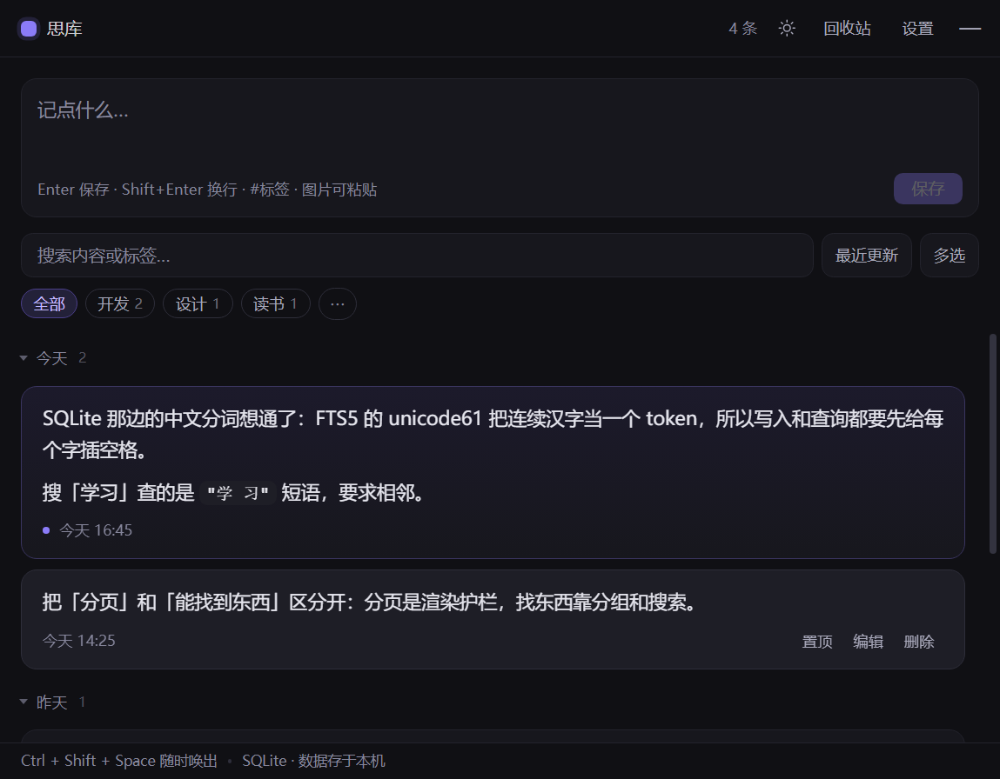
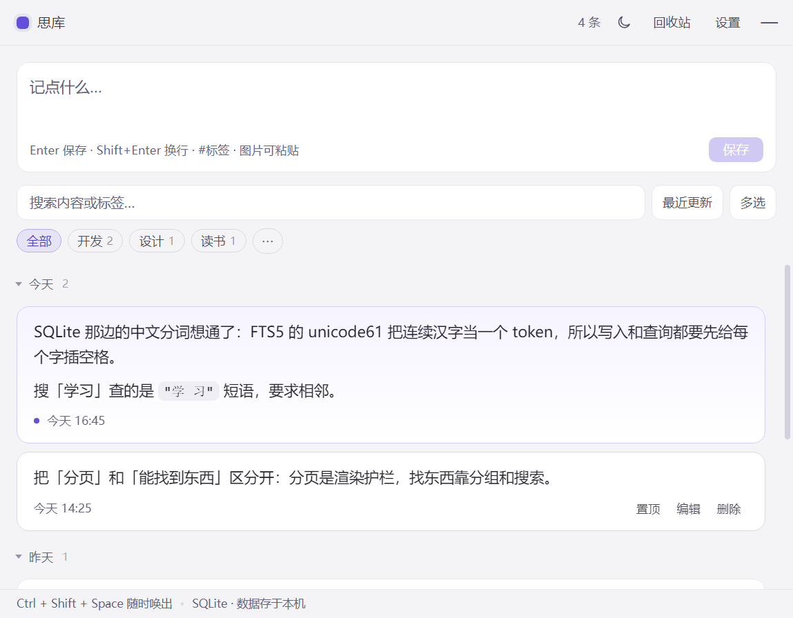

# 此项目完全使用ai制作

<div align="center">

# 思库 · ThoughtVault

**全局快捷键秒开的随手记。完全离线，数据只留在自己机器上。**


</div>

按 `Ctrl + Shift + Space` 叫出窗口 → 打字 → `Enter` 存下 → 忘了它。想找的时候按 `Ctrl + K` 搜，或者按日期翻。

没有账号、没有同步、没有订阅。断网照用，卸载即删干净。

| 深色 | 浅色 |
|:---:|:---:|
|  |  |

---

## 特性

**记录**

- **全局快捷键**：`Ctrl + Shift + Space` 任何界面唤出，可改
- **秒记**：`Enter` 存下，`Shift + Enter` 换行，`Esc` 收起
- **Markdown**：粗体、列表、代码块、引用、表格都渲染；编辑时仍是纯文本
- **粘贴图片**：`Ctrl + V` 存到本地，正文自动插图
- **草稿保护**：没按回车就关窗口，下次打开内容还在
- **`#标签`**：正文里打 `#开发` 自动归类，点顶部标签筛选

**找得到**

- **全文搜索**：FTS5 倒排索引，中文单字可搜（「学」能搜到「学习」）
- **时间分组**：按天分节、标题吸顶；超过 7 天的默认收起
- **键盘流**：`↑` `↓` 上下选，`Enter` 进编辑，手不离键盘
- **排序**：最近更新 / 最新创建 / 篇幅最长

**不怕丢**

- **回收站**：删除先入回收站，30 天自动清理；删完 6 秒内可撤销
- **自动备份**：每次启动备份一份 `.db`，滚动保留 7 份
- **导出 / 导入**：全量导 Markdown 或 JSON，导入按 id 去重
- **数据可搬家**：设置里换目录，笔记、图片、备份、草稿一起走，原位置保留

**桌面集成**

- 托盘常驻、开机自启、失焦自动收起、窗口位置记忆
- 亮 / 暗 / 跟随系统，三档字号
- 多选批量删除与批量打标签，标签可改名（会同步改写正文里的 `#旧名`）

## 快捷键

| 按键 | 作用 |
|---|---|
| `Ctrl + Shift + Space` | 唤出 / 收起窗口（全局） |
| `Enter` | 保存 |
| `Shift + Enter` | 换行 |
| `Ctrl + K` | 聚焦搜索 |
| `Ctrl + V` | 粘贴图片 |
| `↑` `↓` / `Enter` | 列表中选择 / 编辑 |
| `Ctrl + A` | 多选模式下全选 |
| `Ctrl + ,` | 设置 |
| `Esc` | 逐层退出（设置 → 编辑 → 回收站 → 收起窗口） |

## 快速开始

```bash
npm install

npm run app       # 构建前端并启动桌面版
npm run dev       # 只在浏览器看界面（数据走 localStorage）
npm run dist      # 打 Windows 安装包 + 免安装版
```

> **首次安装注意**：`better-sqlite3` 是原生模块，仓库里带了一份 Electron 33 / win32-x64 编好的二进制，多数情况 `npm install` 后可直接用。若 `node_modules` 被整体重装，需要 Python ≤ 3.11 + VS Build Tools 重编，详见文末折叠块。

## 几个设计取舍

做这个东西的过程中，真正花时间的不是写功能，是这几个决定：

| 决定 | 为什么 |
|---|---|
| **存储从 JSON 换成 SQLite** | 原来每次保存都序列化整个数组重写文件，5000 条要 300ms、输入掉帧。现在是单行 UPDATE。顺带拿到了 FTS5 索引和 `EXPLAIN QUERY PLAN` 可验证的排序路径 |
| **中文分词自己做了 `segment()`** | FTS5 的 `unicode61` 把连续汉字当成一个 token，搜「学习」搜不到「今天学习」。做法是写入和查询时都给每个汉字前后插空格，让每字独立成 token，查询用短语匹配 |
| **分页不是用来「找到东西」的** | 列表按 80 条一页滚动加载，那是渲染护栏。真正的检索靠搜索 + 时间分组 + 标签，三件不同的事不能互相替代 |
| **标签以正文为唯一真相** | 早期由渲染层解析标签再传给主进程，任何绕过界面的入口都会产生「正文有 `#tag`、标签表却是空」的脏数据。现在 `createNote/updateNote` 在 main 侧统一解析 |
| **备份用 `VACUUM INTO`** | 原来直接复制 `.db` 文件——WAL 模式下可能拷到写入中的半截状态。`VACUUM INTO` 产出的是独立的紧凑副本 |
| **启动路径上不放重活** | 完整性校验和备份都在主线程上，1 万条下合计 83~117ms，原本堵在创建窗口之前。现在日常启动只做 `quick_check`（比完整校验快 3 倍），备份延后到首屏渲染之后，关键路径从 83ms 降到 3ms。完整校验只留给数据目录搬迁这种低频高危操作 |

## 数据在哪

默认 `%APPDATA%\思库\`，可以在设置里改到任意目录：

```
notes.db       全部笔记（SQLite + WAL），回收站在里面（deleted_at 字段）
assets/        粘贴的图片，正文用  引用
draft.json     未提交的草稿
backups/       自动备份，保留最近 7 份
logs/app.log   异常日志
```

`config.json` 例外，永远留在 `%APPDATA%\思库\`——它是「指针」，记着数据被指到了哪。

图片走自定义协议 `tv-asset://`，只放行 `assets/` 目录内白名单后缀（png/jpg/jpeg/gif/webp）的文件，不构成任意文件读取。

换位置的四种情况：

| 情况 | 行为 |
|---|---|
| 目标目录为空 | 复制过去并切换，**原位置保留**，随时可回退 |
| 目标已有 `notes.db` | 弹窗确认后才切过去，不覆盖任何一边 |
| 取消 / 目录不可写 | 中止，当前数据不动 |
| 新位置打不开 | 自动回滚到原位置，报错提示 |

## 测试

12 套脚本，全部在真实 Electron 里跑（真窗口、真 SQLite、真文件系统），不是 mock。
其中 4 套是纯数据/纯逻辑，无头环境也能跑：

```bash
npm test               # 一次跑完 10 套并汇总（任一失败非零退出）
npm run test:data      # 只跑不需要窗口的 5 套（CI 用这个）

npm run test:db          # 49 项  数据库层：中文搜索/标签/回收站/导入/迁移/schema 版本
npm run test:datadir     # 17 项  数据目录搬迁：复制/切换/取消/回滚/不可写
npm run test:nav         # 20 项  导航边界：外链白名单，javascript:/data:/file: 一律挡掉
npm run test:consistency #  6 项  标签正则与版本号不许在多处漂移
npm run test:logger      #  9 项  日志轮转：超 2MB 只留一份 app.log.1
npm run test:assets-scan # 11 项  图片孤儿扫描的纯逻辑（引用提取 / 孤儿判定）
npm run test:groups      # 11 项  时间分组与键盘导航
npm run test:paging      #  7 项  灌 300 条验分页与滚动续载
npm run test:batch       #  5 项  多选批量删除（端到端：点勾选 → 点删除 → 查库）
npm run test:edge        # 14 项  边界攻击：FTS 注入、XSS、12 万字、畸形导入
npm run test:edge2       # 10 项  连续操作、空态、批量标签、图片类型白名单
npm run smoke            # 13 项  界面端到端 + 五张截图
```

这套断言抓出过 4 个真 bug，其中两个是致命的：**Vue 的响应式 Proxy 过不了 IPC 导致笔记根本存不进文件**、**批量删除同样因为 Proxy 静默失败**。这两个都是「界面看起来正常，重启/刷新才发现没了」——没有断言，肉眼永远发现不了。

还有两个基准脚本：

```bash
npm run bench      # 2000 条数据的逐项耗时 + EXPLAIN QUERY PLAN
npm run bench:ui   # 首屏 / 切筛选 / 切排序 / 续载的渲染耗时
```

还有一个只读的维护脚本，用来找出「没有任何笔记引用」的图片：

```bash
npm run scan:assets                       # 用配置里的数据目录
npm run scan:assets -- --dir=D:/我的思库    # 指定数据目录
```

它只统计、不删除。图片是内容哈希命名的，误判一次就是不可逆的数据丢失，
所以清理这一步留给人来确认（回收站里的笔记也算引用，因为它还能恢复）。

实测（2000 条）：列表首屏 0.6ms、中文搜索 2.0ms、新建 3.6ms、界面切标签 9.5ms。
**瓶颈不在数据库也不在渲染**——所以只优化了真正慢的地方，没有为了数字好看折腾。

真正的瓶颈在启动路径上：完整 `integrity_check` 和 `VACUUM INTO` 备份原本都堵在创建窗口之前，
1 万条下要 83~117ms。改成 `quick_check` + 备份延后到首屏之后，关键路径降到 3ms。

顺带一条我自己踩的：**曾把 `getStats` 的两次 `COUNT` 合并成一次 `SUM(deleted_at IS NULL)`，
理由是「少一次查询」。实测反而慢 2.6 倍**——`COUNT` 走的是覆盖索引的范围查找，
`SUM(表达式)` 必须逐行求值，退化成全索引扫描。做完回头一测才发现，已回滚：

```
COUNT: SEARCH notes USING COVERING INDEX idx_notes_deleted (deleted_at=?)
SUM:   SCAN  notes USING COVERING INDEX idx_notes_deleted
```

省掉一次往返，换来 O(匹配行) → O(全表)。这条现在连同实测数字写在 `electron/db.js` 的注释里。

## v0.9.2 整改（2026-10）

第二轮审视的结论是「数据层已经没有优化空间」，风险都在数据层之外。
按主题拆成 10 个提交，每条都能单独回滚：

| 提交 | 改了什么 | 为什么 |
|---|---|---|
| `fix(security)` | 拦截 `will-navigate` / `setWindowOpenHandler`，外链交给系统浏览器 | 原来点笔记里的链接会把整个窗口导航走，preload 在远程页重新注入，`window.vault` 的全部 IPC 就交给了那个页面 |
| `fix(ui)` | 数据库打不开时显示错误态 | 原来会显示「还没有任何记录」，看着像数据丢了 |
| `fix(db)` | `user_version` 只在升级时写，并补上迁移阶梯 | 原写法每次 `open()` 都覆写版本号，将来加字段会被旧版本改回去 |
| `fix(db)` | 导入时把 `tags` 补写进正文 | 原来用 `raw.tags` 建标签行，正文里却没有 `#标签`，编辑一次就丢 |
| `fix(db)` | 内容未变时不刷新 `updated_at` | 进编辑原样保存会把笔记顶到列表最前面 |
| `perf(db)` | `bootstrap` 支持 `withTags: false` | `listTags` 是唯一线性退化的交互查询（25.6ms @5 万条），但只在写操作后才需要重算 |
| `fix(ui)` | 列表刷新加请求序号、编辑清空给提示、粘贴图片 20MB 上限 | 三个「用户以为成功了其实没有」的场景 |
| `refactor(tags)` | 标签只由 content 解析，浏览器兜底同步校验 | 前端传的 `tags` 参数是死的，两边语义已经分叉 |
| `chore(test)` | `npm test` 统一入口 + 一致性测试 | 7 个脚本以前要逐个敲，容易漏跑 |
| `fix(db)` | FTS 行改用 `notes.rowid` 寻址 | `note_id` 是 UNINDEXED 列，按它删会让 FTS5 全表扫描；导入 5 万条因此从 **128s → 2.6s** |

规模实测（5 万条）：列表 0.32ms、写入 5ms 级、`quickCheck` 162ms、备份 121ms（都在首屏之后）。
**唯一还在退化的交互查询是 `listTags`**（0.87ms → 25.58ms），已经用 `withTags` 按需跳过。

## 目录结构

```
electron/
  main.js       窗口、全局快捷键、托盘、单实例、IPC、导入导出
  db.js         SQLite：建表、FTS5 中文分词、CRUD、标签维护、批量、迁移、备份
  paths.js      数据目录解析（支持运行时切换）
  relocate.js   数据搬迁（依赖注入，可脱离 Electron 测试）
  assets.js     图片落盘 + tv-asset 协议
  config.js     设置持久化
  preload.js    contextBridge 暴露的最小接口
src/
  App.vue       捕获框、列表、Markdown、多选、排序、主题、引导
  api.js        桌面 / 浏览器 双实现，接口一致
  style.css     主题令牌 + Markdown 排版
  components/   SettingsPanel / TagManager / TrashView
scripts/        98 项断言的测试脚本 + 两个基准 + 截图生成
```

## 已知边界

- **仅 Windows 打包**：exe 只能在 Windows 上产出，要 dmg 得在 macOS 上打
- **按字数排序走 `TEMP B-TREE`**：`LENGTH()` 无法走索引，当前 1.1ms，不值得加冗余列
- **分页是「重查前 N 条」**：不是游标分页，2000 条内无感，过万需要改 keyset
- **硬件加速默认关闭**：纯文本工具用不上，老显卡和虚拟机上更稳；要开设 `APP_GPU=1`

<details>
<summary><b>安装包体积与原生模块编译</b></summary>

**体积**：安装包 72MB / 解包 231MB。

- 只保留 `zh-CN` + `en-US` 语言包（Electron 默认 50+ 个 `.pak`，占 41MB）
- `node_modules` 只打运行时依赖——`vue` 会把 `@vue/compiler-sfc` → `@babel/*` 整串编译期依赖拖进 asar，运行时根本不 `require`（asar 18MB → 304KB）
- `compression: maximum`

剩下 231MB 里 `思库.exe`（Chromium + Node）占 181MB，是 Electron 的固定成本。再压只能自编 Electron 或换 Tauri。

**重编原生模块**（`node_modules` 被删掉时需要）：

```bash
npm_config_python="C:/path/to/python3.11/python.exe" npx electron-rebuild -f -w better-sqlite3
```

需要 Python ≤ 3.11（3.12 起移除 `distutils`，node-gyp 会报错）+ Visual Studio Build Tools（C++ 工作负载）。打包配置里 `npmRebuild: false`，复用已编好的二进制。

</details>

## License

[MIT](LICENSE)
